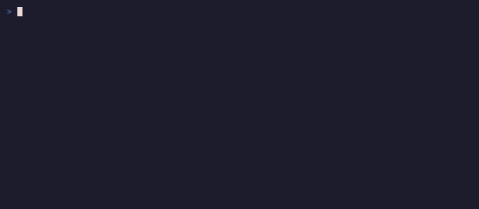

# a2ui-tea

Bubble Tea terminal UIs configured on the fly by [A2UI](https://a2ui.org) messages.



An agent (or any process) streams A2UI messages: `createSurface`, `updateComponents`,
`updateDataModel`, `deleteSurface`. The terminal renders them as a
[Bubble Tea](https://github.com/charmbracelet/bubbletea) program whose component tree,
layout and data are defined at runtime. The UI changes while it runs, with no recompile and
no restart. People interact with it (focus, type, press buttons, pick choices, move sliders)
and those interactions go back out as A2UI `action` messages with their data-bound context.
Components are a flat adjacency list bound to a per-surface JSON data model through JSON
Pointer paths; templates expand arrays into repeated children; renderer-side functions
(`formatString`, `formatDate`, `required`, `and`...) and check rules run locally. The
BasicCatalog is built in and the registry is the extension point for custom catalogs.

It implements the A2UI **v1.0** specification (the `@path` / `@call` binding syntax and the
basic catalog at `catalogs/basic/v1`) and also accepts `v0.9` / `v0.9.1` envelopes of the
same shape. Built on Bubble Tea v2 (`charm.land/bubbletea/v2`), Bubbles v2 and Lip Gloss v2,
the current stable majors.

## Install

```sh
go install github.com/GeorgePearse/a2ui-tea/cmd/a2ui-tea@latest
```

## Run

Three input modes. User actions are written to stdout as JSON lines whenever stdout is not a
terminal; the UI itself always renders on `/dev/tty`.

**stdin**: one JSON message, array of messages or example file per JSON value.

```sh
echo '{"version":"v1.0","createSurface":{"surfaceId":"hi","catalogId":"https://a2ui.org/specification/v1_0/catalogs/basic/catalog.json","components":[{"id":"root","component":"Column","children":["t","b"]},{"id":"t","component":"Text","text":"Hello from an agent"},{"id":"b","component":"Button","child":"l","action":{"event":{"name":"clicked"}}},{"id":"l","component":"Text","text":"Click me"}]}}' \
  | a2ui-tea --stdin
```

Press Enter on the button and `{"version":"v1.0","action":{"name":"clicked",...}}` appears on
stdout. Any of the spec examples work too: `cat testdata/examples/09_login-form.json | a2ui-tea --stdin`.

**file** with watch: the file is re-read and re-rendered whenever it changes, so you can edit
a UI in your editor and see it live.

```sh
a2ui-tea --file testdata/examples/32_advanced-form-validator.json
```

**url**: consumes `text/event-stream` (each `data:` payload is a message or an array) or
newline-delimited JSON, and POSTs each user action back to the same URL as JSON
(`--post` overrides the target).

```sh
a2ui-tea --url http://localhost:8080/a2ui
```

**demo**: a scripted agent that creates a surface and then keeps reshaping it every ~0.9 s
(adds a row of cards, swaps them for a tab set, appends to a template-driven list, adds a
modal) while you tab through it. It answers your actions too: Greet echoes your name back,
Deploy runs a fake rollout.

```sh
a2ui-tea demo
```

Keys: `tab` / `shift+tab` move focus, `enter` / `space` press or toggle, `←` `→` adjust sliders,
switch tabs and chips, `↑` `↓` move in choice lists, `esc` closes a modal, `pgup` / `pgdn`
scroll, `q` or `ctrl+c` quits. `--log trace.log` writes a debug trace, `--no-alt-screen`
renders inline, `--stay` keeps running after the last surface is deleted.

## Library

```go
import (
    "github.com/GeorgePearse/a2ui-tea/a2ui"    // protocol: messages, store, data model, functions
    "github.com/GeorgePearse/a2ui-tea/catalog" // component registry + BasicCatalog renderers
    "github.com/GeorgePearse/a2ui-tea/render"  // the Bubble Tea model
)
```

Create a model, feed it messages (from the Bubble Tea loop with `render.MessagesMsg`, or
directly with `Apply`), and read actions from the `Outbound` callback:

```go
m := render.New(render.Options{
    Outbound: func(out a2ui.Outbound) { json.NewEncoder(os.Stdout).Encode(out) },
})
p := tea.NewProgram(m)
go func() {
    msgs, _ := a2ui.ParseMessages(payload)
    p.Send(render.MessagesMsg(msgs))
}()
p.Run()
```

### Register a custom component

A component is anything that renders a node at a width. Optional interfaces add children
(`Container`), keyboard focus (`Focusable`) and overlays (`Overlay`).

```go
type Gauge struct{}

func (Gauge) Render(f catalog.Frame, n a2ui.Node, width int) string {
    v, _ := f.Eval().Number(n.Component.Props["value"], n.Scope) // resolves literals, @path, @call
    filled := int(v * 10)
    return n.Component.StringProp("label", "") + " " +
        strings.Repeat("●", filled) + strings.Repeat("○", 10-filled)
}

reg := catalog.Basic()
reg.Register("Gauge", Gauge{})
m := render.New(render.Options{Registry: reg})
```

Now `{"id":"root","component":"Gauge","label":"CPU","value":{"@path":"/cpu"}}` renders
`CPU ●●●●●○○○○○`, re-renders when `/cpu` changes, and works under any `catalogId`. Catalog
functions are registered the same way on the evaluator:
`ev := a2ui.NewEvaluator(); ev.Register("upper", func(e *a2ui.Evaluator, args map[string]any, s *a2ui.Scope) (any, error) { ... })`.

## Spec coverage

| Area | Status |
| --- | --- |
| `createSurface` (incl. inline `components` / `dataModel`, `sendDataModel`), `updateComponents`, `updateDataModel` (upsert, delete with `null`, root replace), `deleteSurface` | ✅ |
| `callRendererFunction` → `rendererFunctionResponse` | ✅ |
| `agentFunctionResponse`, `callAgentFunction` | parsed / not initiated |
| Data binding: `@path` absolute and relative paths, template `ChildList`, `@index`, v0.9 `{"path"}` alias | ✅ |
| Functions: `required`, `regex`, `length`, `numeric`, `email`, `formatString` (nested calls, escapes), `formatNumber`, `formatCurrency`, `formatDate` (TR35 subset), `pluralize`, `and`, `or`, `not`, `openUrl` (http/https only, hook) | ✅ |
| Check rules: `ValidationResult` coercion, messages under inputs, disabled buttons | ✅ |
| Actions: `event` with resolved `context` and `userMessage`; local `functionCall`; `error` messages for integrity/validation failures | ✅ |
| Data model sync (`sendDataModel`): emitted as a separate `{"rendererDataModel": ...}` line | ✅ (transport is JSON lines, not A2A) |
| Text (Markdown subset: headings, bold, italic, code, links, bullets), Icon (glyph map), Divider | ✅ |
| Row / Column / List: `weight`, `justify`, `align`, vertical dividers, templates | ✅ (List does not scroll on its own; the whole view scrolls) |
| Card, Tabs (←/→), Modal (overlay, esc closes; the trigger's event is still dispatched) | ✅ |
| Button (`primary`, `borderless`, checks), TextField (`obscured`, placeholder; `longText` is single-line), CheckBox, ChoicePicker (radio / checkbox / chips; `filterable` ignored), Slider (`steps`), DateTimeInput (free-form ISO text; `min` / `max` ignored) | ✅ |
| Image / Video / AudioPlayer | placeholder box with description and URL (inline Kitty/Sixel images: later) |
| `accessibility`, `metadata.extensions`, catalog `allowedParents` / `allowedChildren` validation, mixed catalogs per component (`catalogId`) | ignored (components resolve by type name only) |
| v0.8 messages (`beginRendering`, `surfaceUpdate`, `dataModelUpdate`) | ❌ |

Golden tests render every example from the spec's basic catalog at widths 60, 80 and 120
(`testdata/golden`, regenerate with `go test ./render -run Golden -update`). The examples
under `testdata/examples` are copied from the A2UI project (Apache-2.0, see the NOTICE there).

## Licence

MIT, see [LICENSE](LICENSE).
